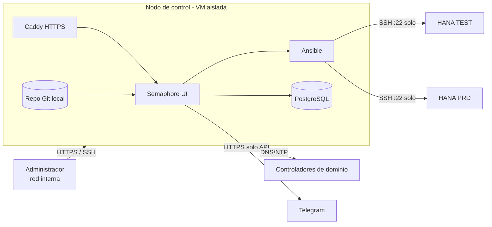

# Reinicio automatizado de SAP HANA con Ansible + Semaphore UI

Ejemplo de referencia para automatizar el **reinicio de SAP HANA** (y opcionalmente del sistema operativo SLES) desde un **nodo de control aislado**, usando **Ansible** orquestado con **Semaphore UI**, con alertas por **Telegram**.

Pensado para entornos donde:

- El servidor HANA tiene un **Python antiguo** (p. ej. 3.6 en SLES 15 SP4) que no se puede tocar → todas las tareas usan `ansible.builtin.raw` (comandos por SSH, sin Python en el destino).
- **TEST y PRD son clones** (mismo hostname, mismo SID, incluso mismas claves de host SSH) → la identidad del servidor se garantiza con **varias capas de control independientes**.
- El procedimiento manual vigente es `su - <sid>adm` → `./HDB stop` / `./HDB start` / `./HDB info`, y la automatización lo replica sin atajos (nunca `HDB kill`).

> Todos los valores de este repositorio son **ejemplos**: IPs de documentación (`192.0.2.0/24`, `198.51.100.0/24`), nombres genéricos y secretos vacíos. Reemplazarlos antes de usar.

---

## Arquitectura



- **Sin salida a internet** salvo la API de Telegram (alertas).
- **Firewall del hipervisor** (Proxmox) restringe la salida de la VM: solo SSH a los HANA, DNS/NTP a los DCs y HTTPS a Telegram.
- **Repositorio Git local** montado en solo lectura dentro del contenedor de Semaphore.

## Estructura

```
.
├── semaphore/                  # Despliegue de Semaphore (Docker Compose)
│   ├── docker-compose.yml
│   ├── Caddyfile.example
│   ├── .env.example
│   ├── gen-env.sh              # genera .env con secretos aleatorios
│   └── install-docker.sh
├── hana-automation/            # Proyecto Ansible (va al repo Git local)
│   ├── ansible.cfg
│   ├── inventory/
│   │   ├── test.yml            # solo TEST
│   │   ├── prd.yml             # solo PRD (sobrescribe listas permitidas)
│   │   └── group_vars/hana.yml
│   ├── playbooks/
│   │   ├── hana_check.yml      # SOLO LECTURA
│   │   ├── hana_restart.yml    # bajar y subir HANA
│   │   └── hana_os_reboot.yml  # bajar HANA, reiniciar SO, subir HANA (no probado en PRD)
│   └── roles/hana_ops/
└── docs/
    ├── nodo-control.md
    ├── preparacion-servidor-hana.md
    ├── semaphore.md
    ├── seguridad.md
    └── troubleshooting.md
```

## Flujo del reinicio (`hana_restart.yml`)

1. **Candados:** entorno permitido, IP permitida, marca `/etc/hana-env` del servidor, sin Pacemaker.
2. **Estado previo:** `./HDB info` + `sapcontrol GetProcessList`. Solo se baja si HANA está **100 % GREEN** (rc=3).
3. **Chequeo de backups en curso** (`M_BACKUP_CATALOG`); si hay uno corriendo espera y reintenta, y si persiste **aborta sin bajar HANA**.
4. **Bajada:** `./HDB stop` → `sapcontrol WaitforStopped` (tope 30 min) → confirma todo GRAY (rc=4).
5. **Subida:** `./HDB start` → `sapcontrol WaitforStarted` (tope 45 min) → confirma todo GREEN (rc=3).
6. Ante cualquier fallo o timeout: **se detiene, alerta y deja HANA como esté** para intervención manual.

Los tiempos son **topes de seguridad**, no son esperas fijas: el playbook avanza apenas HANA termina (consulta cada 10 s).

## Capas de protección (TEST ≠ PRD)

| # | Capa | Dónde | Qué impide |
|---|---|---|---|
| 1 | Firewall del hipervisor | Proxmox | Conectar a cualquier host no autorizado |
| 2 | Inventario y proyecto Semaphore separados | Repo / Semaphore | Mezclar entornos |
| 3 | Listas de entornos e IPs permitidas | Playbook | Ejecutar contra una IP o entorno no habilitado |
| 4 | Usuario y clave SSH distintos por entorno, con `from="<IP del nodo>"` | Servidor HANA | Que la clave de TEST entre a PRD |
| 5 | Marca `/etc/hana-env` (`TEST`/`PRD`) | Servidor HANA | Actuar si el servidor no es el esperado |

## Resultados de referencia

| Entorno | Memoria HANA antes | Después | Duración total |
|---|---|---|---|
| TEST | ~80 GB | ~54 GB | ~5,5 min |
| PRD | ~160 GB | ~74 GB | ~6 min |

(La memoria vuelve a crecer con el uso; el valor sirve para dimensionar la frecuencia de reinicio.)

## Puesta en marcha (resumen)

1. Nodo de control: VM Linux + Docker + Semaphore → [docs/nodo-control.md](docs/nodo-control.md)
2. Servidores HANA: marca, usuario y clave por entorno → [docs/preparacion-servidor-hana.md](docs/preparacion-servidor-hana.md)
3. Semaphore: proyectos, inventarios, templates, alertas y schedule → [docs/semaphore.md](docs/semaphore.md)
4. Seguridad y firewall → [docs/seguridad.md](docs/seguridad.md)

**Orden recomendado de pruebas:** chequeo de solo lectura en TEST → reinicio manual supervisado en TEST → chequeo en PRD → reinicio manual supervisado en PRD → schedule.

## Requisitos probados

- Nodo de control: Ubuntu Server 26.04 LTS, Docker, Semaphore UI v2.19.14 (ansible-core 2.20).
- Servidores: SLES 15 SP4, SAP HANA 2.0 SPS05, SAP Business One, Python 3.6 (sin modificar).
